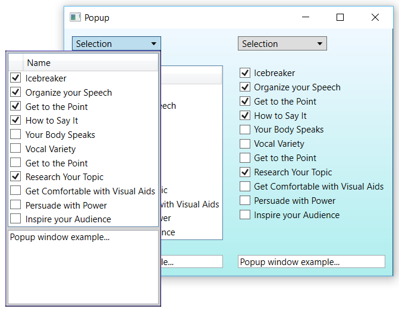

## Popup

WPF demo of two ways to build a drop-down popup that edits shared view-model state:

* **Left** – popup content declared inline in the window, bound to the toggle button's `IsChecked`.
* **Right** – popup content is a reusable `MyUserControl`, opened through a view-model property.

All views (popup, read-only grid, checkbox list, text boxes) are bound to the same data, so changes show up everywhere immediately.

